  

  
  
  
  

---

### `whoami`

I build **small, auditable command-line tools for security review** — MCP configs, lockfiles, cryptography, firewall rules, incident drills and AI-agent memory forensics. Each tool does a single job and documents what it **cannot** do. I'd rather ship a tool that is honest about its blind spots than one that overstates what it catches.

Everything here is a **personal project**, verifiable from the public code. There are no certifications or employers listed because none have been added yet; the code is the proof.

---

### `ls ~/tools`   —   7 tools

| Tool | What it does |
|------|--------------|
| **[mcp-lantern](https://github.com/0xM44k/mcp-lantern)** | Flags which combinations of your MCP servers can leak data or run injected commands (the "lethal trifecta") |
| **[ramnesia](https://github.com/0xM44k/ramnesia)** | Carves AI-agent traces — prompts, tool calls, secrets, model identity — out of a memory dump |
| **[ruleglass](https://github.com/0xM44k/ruleglass)** | Analyses `iptables` rulesets and traces a packet through them, saying `UNCERTAIN` when it can't be sure |
| **[scopekeeper](https://github.com/0xM44k/scopekeeper)** | A scope guard + tamper-evident hash-chained log for authorised security testing |
| **[lockdiff](https://github.com/0xM44k/lockdiff)** | Diffs two `package-lock.json` files for tamper signals, offline — not advisories |
| **[cryptoscan](https://github.com/0xM44k/cryptoscan)** | Inventories a codebase's cryptography and ranks what to migrate first for post-quantum |
| **[tabletop](https://github.com/0xM44k/tabletop)** | Generates a realistic incident-response tabletop exercise from your own environment |

Every one is offline-first, dependency-light, and emits machine-readable output (JSON / SARIF / CBOM) so it can gate a pipeline.

---

### `cat skills.txt`

**Interests:** networking · Linux & operating systems · cryptography · security research · agents & MCP · memory forensics.

---

### `./approach --how`

- **Build to spec.** The smallest tool that answers one question beats a framework that answers none well.
- **Work against reality.** ruleglass is built around the real Linux kernel's behaviour; scopekeeper's log is tamper-evident by construction; ramnesia reads real memory layouts.
- **State the limits.** Every tool ships a "what it does *not* catch" list. That list is the senior part.

---

  <code>m11k.08k3@gmail.com</code> · built from scratch · no analytics, no trackers

